<p align="center">
  <picture>
    <source media="(prefers-color-scheme: dark)" srcset="media/banner-dark.svg">
    <source media="(prefers-color-scheme: light)" srcset="media/banner-light.svg">
    
  </picture>
</p>
<p align="center">
  <a href="https://github.com/Amatya27/delivery-performance-analytics/actions/workflows/tests.yml"></a>
  <a href="https://amatya27.github.io/delivery-performance-analytics/"></a>
  
  
  
  
  
</p>

I wanted a project where I take real, messy operations data all the way to something a business team could actually use: a clean database, a dashboard that tracks delivery KPIs, and a model that flags orders likely to arrive late before they even ship.

The data is the Olist public e-commerce dataset, about 100k real (anonymized) orders from a Brazilian marketplace between 2016 and 2018. Each order has the purchase time, when the seller handed it to the carrier, when the customer got it, and the delivery date the customer was promised. That last part is what makes it useful for delivery analysis.

**Interactive report (no install needed):** https://amatya27.github.io/delivery-performance-analytics/

**Tableau Public dashboard:** _link coming once it's published_

## What's in here

```
raw CSVs (9 tables)
  -> src/etl.py           clean, reconcile, compute delivery timings and distances
  -> data/delivery.db     SQLite star schema + KPI views (sql/)
  -> src/model.py         late delivery model + monthly monitoring tables
  -> src/stats_tests.py   does lateness actually hurt reviews?
  -> src/export_tableau.py  flat CSVs in tableau/ for the dashboard
  -> src/plot_trends.py     interactive Plotly charts in reports/
```

| Folder | What it has |
|---|---|
| `src/` | the Python scripts above |
| `sql/` | `schema.sql` (tables) and `kpi_views.sql` (monthly KPIs, state, lane, category, seller scorecard) |
| `tableau/` | the CSVs the Tableau dashboard is built from |
| `reports/` | data quality report, model metrics, stats results, Plotly charts |
| `tests/` | pytest unit tests for the ETL logic, plus a check on the built database |

## What I found

Out of 96,470 delivered orders, **6.8% arrived after the promised date.**

- **Late deliveries wreck reviews.** Late orders average 2.27 stars vs 4.29 for on-time ones, and 62% of late orders got a 1 or 2 star review compared to 9% of on-time orders (Mann-Whitney and chi-square both p < 0.001, bootstrap 95% CI for the difference in means is -2.06 to -1.98 stars).
- **There are two bad periods.** On-time rate dropped to 87.6% for November 2017 purchases (Black Friday volume) and to 81.0% in March 2018. Most other months sit between 93 and 97%.
- **The northeast is where it goes wrong.** About 71% of delivered orders ship from Sao Paulo sellers, so orders going to states like Alagoas (21% late) and Maranhao (17% late) travel 1,800 km or more. Sao Paulo itself is at 4.5%. The worst high-volume lane is SP -> AL.
- **Distance matters, but it isn't everything.** Distance and delivery time have a Spearman correlation of 0.54. Rio de Janeiro is only about 490 km from most sellers but still runs a 12% late rate.
- **Payments mostly reconcile.** Payment totals match items + freight within 1 BRL for all but 313 of 98,666 orders. Most of the mismatches were paid in installments and came out higher than the item total, which looks like installment interest. The full list of checks is in `reports/data_quality.md`.

## The late delivery model

**Question:** when an order is placed, can we tell which ones are likely to miss their promised date, so the ops team can watch them or the promise can be adjusted?

**Setup**
- Trained on 2017 orders, tested on January to August 2018. I used a time split on purpose, a random split would let the model peek at the same weeks it's tested on.
- Only features known at purchase time: promised days, seller to customer distance, freight, weight, product category, states, payment type, and some history features.
- The history features were the part I spent the most time on: the seller's past late rate and average delivery time, and the late rate / average delivery time into the customer's state over the last 14 days. They only use deliveries that were *completed before* the purchase (`pd.merge_asof` with `allow_exact_matches=False`), so there's no leakage.
- `promise_slack_days` = days promised minus how long deliveries into that state have recently been taking. This ended up as one of the strongest features.

**Results on the 2018 test set (52,777 orders, 7.7% late)**

| | ROC AUC | PR AUC | Precision if we flag top 10% | Late orders caught (top 10%) |
|---|---|---|---|---|
| Rule: shortest promise first | 0.529 | 0.088 | 8.7% | 11.3% |
| Logistic regression | 0.706 | 0.166 | 20.9% | 27.0% |
| **Gradient boosting (used)** | **0.706** | **0.171** | **21.5%** | **27.8%** |

The two models rank orders about equally well. I went with gradient boosting because its probabilities are much better calibrated (Brier score 0.069 vs 0.264, the logistic regression used balanced class weights which pushes all the probabilities up). Flagging the riskiest 10% of orders gives a list that is about 2.8x more likely to be late than a random order.

**Monitoring.** `model_monitoring` in the database (and the second dashboard page) tracks the model month by month. The interesting part is February and March 2018: the actual late rate jumped to 14 and 19%, but the model only predicted 7 to 8%. It still ranked orders fine (ROC AUC 0.67 to 0.71 those months), so the flag list stayed useful, but the probabilities were off. In a real setup that's the signal to recalibrate or retrain.

**Things I tried that didn't work**
- Adding purchase month as a feature. With only one year of training data it basically memorized 2017 and test ROC AUC dropped from about 0.71 to 0.69, so I took it out.

## Data model

Star schema in SQLite (`sql/schema.sql`):

- `fact_orders`: one row per order with timings (approval, seller handling, carrier transit, total), promised vs actual dates, totals, payment reconciliation and review
- `fact_order_items`: one row per item with price, freight and seller to customer distance
- `dim_customer`, `dim_seller`: location with lat/lng (median of the geolocation points for the zip prefix, points outside Brazil dropped)
- `dim_product`: category (translated to English), weight and size
- `dim_date`: calendar table

Views in `sql/kpi_views.sql` do the KPI math (on-time rate by month, state, lane, category, and a seller scorecard), and the Tableau exports are queried from them.

## How to run it

Needs Python 3.10+.

```bash
python -m venv .venv
source .venv/bin/activate
pip install -r requirements.txt

./run_all.sh      # download data -> ETL -> model -> stats -> exports -> charts
pytest -q         # tests
```

The full run takes about a minute after the download. The raw data (~125 MB) and the database aren't in the repo, `src/get_data.py` downloads the data again.

## Limitations / what I'd do next

- Orders that hadn't been delivered when the data was pulled aren't in the analysis, so the last month or two probably look a bit better than they really were.
- The promised date is whatever Olist showed the customer. A natural next step is using the model to suggest a better promised date instead of just flagging risk.
- Retrain monthly and add a calibration step, based on what the monitoring showed for Feb/Mar 2018.
- Freight cost modeling per lane would be a good second model with the same tables.

## Data

[Olist Brazilian e-commerce public dataset](https://github.com/olist/work-at-olist-data), released by Olist under the MIT License.
